# 💾 sqlite-shadow-sync

Safe, zero-lock, automatic background shadow backups for SQLite in Node.js. Safe for **Write-Ahead Log (WAL) mode**, with built-in compression, background watching, and integrity verification checks.

## 🎬 Demo

<p align="center">
  
</p>

---

## ✨ Features

- **🔒 Safe WAL Backups**: Monitors transaction states and locks on Write-Ahead Log (`-wal`) logs to copy the database safely without partial page transactions.
- **🚀 Zero-Lock / Non-Blocking**: Does not lock the primary thread or block write requests on SQLite during operation.
- **🛠️ Active & Passive Synchronization**:
  - **Active**: Integrates natively with `better-sqlite3` and `sqlite3` APIs for safe active connection page copies.
  - **Passive**: Automatically watches the filesystem for changes and runs safe background checkpoints without requiring an active connection handle.
- **📦 Gzip Compression**: Streaming GZip compressor keeps memory usage at zero while saving up to 80% storage space.
- **🔄 Auto-Rotation**: Cleans up older historical backups automatically (configurable `maxBackups`).
- **🛡️ Integrity Checks**: Validates database signatures before committing each backup file, avoiding corrupted shadows.

---

## 📦 Installation

```bash
npm install sqlite-shadow-sync
```

_(Optional peers: `better-sqlite3` or `sqlite3` for active backups)_

---

## 🚀 Usage

### 1. File-Watcher / Passive Mode (Zero-Connection)

Runs passively in the background. It watches the SQLite `.db` file, waits for a silent period with no active write changes (the idle timeout), and backs it up safely.

```javascript
import { SqliteShadowSync } from "sqlite-shadow-sync";

const shadow = new SqliteShadowSync({
  dbPath: "./data/prod.db",
  backupDir: "./backups",
  watch: true, // Enable filesystem watching
  idleTimeoutMs: 3000, // Wait 3s after last write before copying
  compress: true, // Gzip compression (.db.gz)
  maxBackups: 10, // Keep last 10 backups
  onBackupSuccess: (path) => console.log(`✓ Backup saved: ${path}`),
  onBackupFailure: (err) => console.error(`✗ Backup failed:`, err),
});

// Stop background watchers when application shuts down
// shadow.destroy();
```

### 2. Time-Interval Mode

Performs automated backups on a custom timing interval loop.

```javascript
const shadow = new SqliteShadowSync({
  dbPath: "./data/prod.db",
  backupDir: "./backups",
  intervalMs: 1000 * 60 * 60 * 2, // Backup every 2 hours
  compress: true,
});
```

### 3. Active Connection Backup (Manual trigger)

Trigger backups manually or from server tasks. If you provide an active SQLite connection (e.g. from `better-sqlite3`), it leverages native database backup handlers.

```javascript
import Database from "better-sqlite3";
import { SqliteShadowSync } from "sqlite-shadow-sync";

const db = new Database("prod.db");

const shadow = new SqliteShadowSync({
  dbPath: "./prod.db",
  backupDir: "./backups",
});

// Trigger backup using active DB connection handles
await shadow.backup({ dbConnection: db });
```

---

## ⚙️ API Configuration Reference

| Option          | Type      | Default     | Description                                                                                           |
| :-------------- | :-------- | :---------- | :---------------------------------------------------------------------------------------------------- |
| `dbPath`        | `string`  | _Required_  | Absolute or relative path to the source SQLite database file.                                         |
| `backupDir`     | `string`  | _Required_  | Directory where shadow backup files are saved.                                                        |
| `intervalMs`    | `number`  | `undefined` | Triggers a backup at the specified interval in milliseconds.                                          |
| `maxBackups`    | `number`  | `10`        | Maximum backup count to maintain. Older files are automatically rotated out. (Set `0` for unlimited). |
| `compress`      | `boolean` | `true`      | Stream compress backup files using high-level gzip. (.db.gz)                                          |
| `watch`         | `boolean` | `false`     | Enable standard FSWatcher to detect database file writes.                                             |
| `idleTimeoutMs` | `number`  | `2000`      | Delay in milliseconds to wait for writes to quiet down before copying.                                |

---

## 📄 License

MIT
